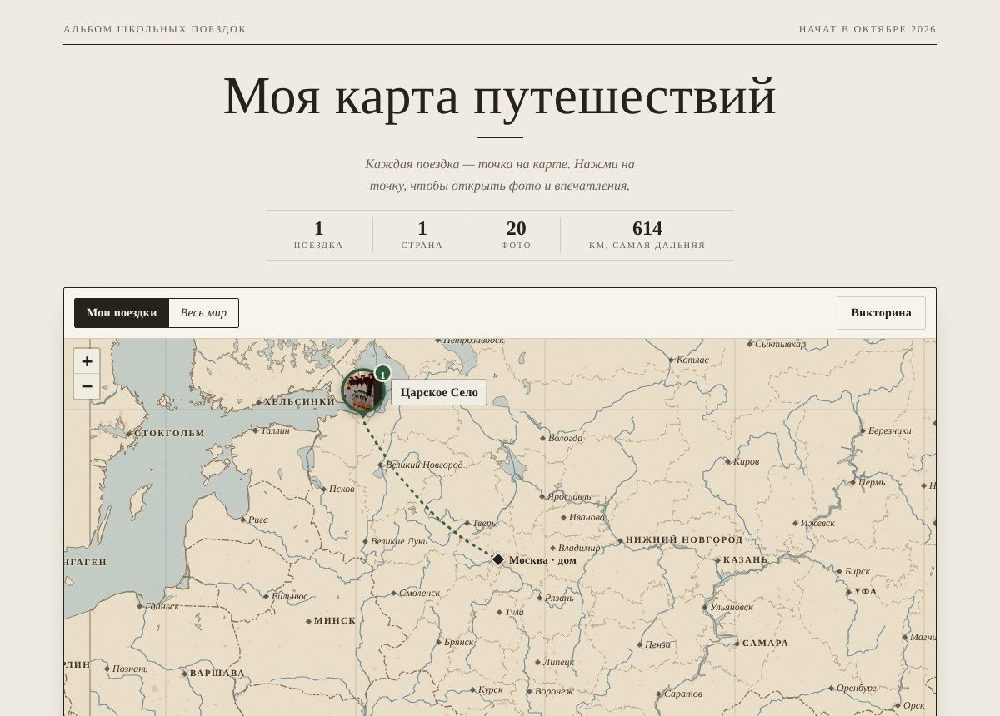
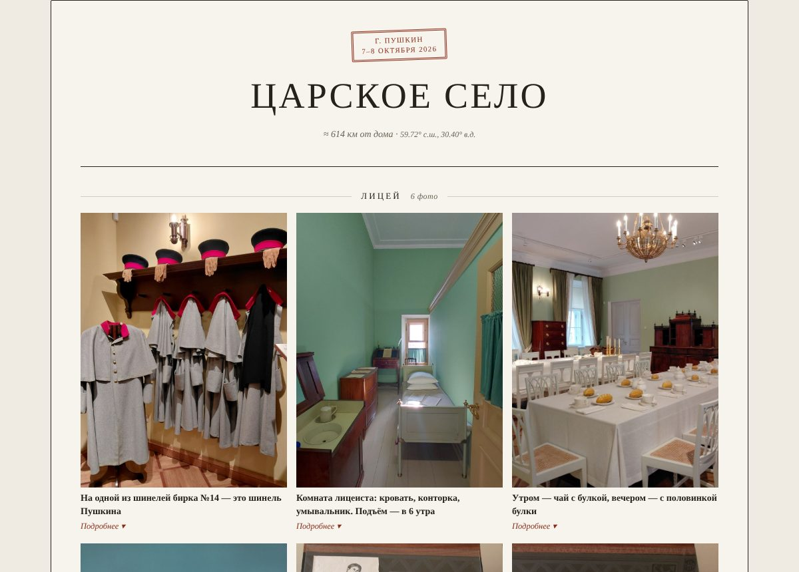
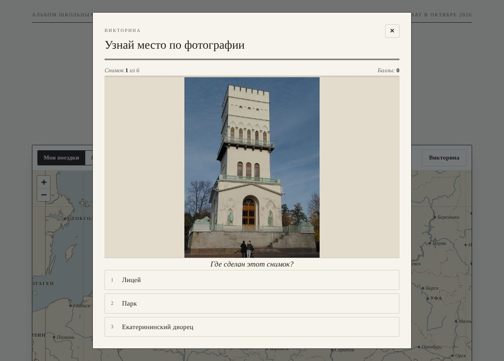

# Моя карта путешествий

Путевой дневник школьных поездок в стиле старинного атласа. Каждая поездка — точка на карте, за ней — фотоальбом по главам, короткие истории о местах и главное о поездке своими словами.

Ссылка на сайт — в разделе **About** справа.



## Что умеет

- **Карта в стиле атласа.** Пергаментная суша, реки, границы, сетка меридианов; маршрут от дома до каждой поездки. Кнопки «Мои поездки» и «Весь мир». При сильном приближении видны улицы.
- **Фотоальбом по главам.** Под каждым снимком — одна короткая строка, подробности открываются по кнопке «Подробнее». Снимки открываются на весь экран.
- **Загадки о местах.** Факты о поездке поданы как карточки-вопросы: сначала попробуй ответить сам, потом нажми — откроется ответ с короткой историей.
- **Все поездки по годам или по странам.** Нажатие на группу показывает её поездки на карте.
- **Каталог и поиск.** Переключатель «Карта / Каталог»: в каталоге поездки показаны карточками с обложками. Поиск ищет по названиям, местам, главам, подписям к фото и историям; клавиша `/` переходит к поиску, `Esc` очищает его.
- **Режим «Книга».** Поездка читается как путевой дневник: обложка, вступление, содержание с переходами к главам, крупные фотографии, истории и главное о поездке. Кнопка «Обычный альбом» возвращает прежний вид.
- **Печать / PDF.** Альбом или книгу можно распечатать или сохранить в PDF через окно печати браузера («Сохранить как PDF»).
- **Викторина «Узнай место по фотографии».** 6 случайных снимков, 3 варианта ответа, пояснение после каждого ответа, баллы и рекорд. Каждая новая игра берёт снимки, которых ещё не было.
- **Обложка и штемпели.** Каждая поездка открывается фото-обложкой с почтовым штемпелем; в шапке собирается коллекция штемпелей — по нажатию открывается поездка.
- Светлая и тёмная тема, удобно на телефоне.





## Как устроен проект

Сайт — одна страница без сборки и серверной части, опубликован через GitHub Pages.

| Файл | Что это |
|---|---|
| `index.html` | страница: разметка, стили и код |
| `trips.json` | все поездки: тексты, точки на карте, подписи к фото |
| `basemap.json` | подложка карты (суша, реки, границы, города) в формате TopoJSON |
| `photos/<поездка>/` | фотографии, по папке на поездку |
| `docs/` | скриншоты для этого описания |

### Как описана поездка в `trips.json`

```json
{
  "id": "tsarskoe-selo",
  "title": "Царское Село",
  "country": "Россия",
  "place": "г. Пушкин",
  "date": "2026-10-07",
  "dateTo": "2026-10-08",
  "cover": 17,
  "lat": 59.7163, "lon": 30.3958,
  "chapters": ["Лицей", "Александровский дворец"],
  "photos": [
    { "src": "photos/tsarskoe-selo/01.jpg", "chapter": "Лицей",
      "short": "Одна короткая строка под фото",
      "caption": "Подробный текст под кнопкой «Подробнее»" }
  ],
  "places": [ { "name": "Лицей", "chapter": "Лицей", "lat": 59.7183, "lon": 30.3953 } ],
  "facts": [ { "chapter": "Лицей", "q": "Вопрос-загадка", "title": "Короткий ответ", "text": "История-пояснение" } ],
  "notes": { "text": "Главное о поездке своими словами" }
}
```

Чтобы добавить поездку: положить фото в новую папку `photos/<id>/` и дописать объект в `trips.json`. Поля `cover`, `places`, `facts`, `notes` необязательны. `cover` — номер фото для обложки (по порядку в `photos`, с 1); без него обложкой станет первое фото. Если у фактов есть поле `q`, они показываются карточками-загадками; без `q` — обычным списком историй (`top: true` — видна сразу, остальные под «Ещё истории»). Переносы строк в `text` (`\n`) сохраняются — так удобно приводить стихи. Фото без `chapter` попадают в общий раздел, а в викторине отвечают названием поездки.

## Благодарности и источники

- Подложка карты: [Natural Earth](https://www.naturalearthdata.com/) — общественное достояние.
- Улицы при приближении: © участники [OpenStreetMap](https://www.openstreetmap.org/copyright).
- Библиотеки: [Leaflet](https://leafletjs.com/) (BSD-2-Clause), [topojson-client](https://github.com/topojson/topojson-client) (ISC).
- Шрифт PT Serif — ParaType, лицензия SIL Open Font License.
- Исторические факты — по книге «А. С. Пушкин» (изд-во «Белый город»), статье [Arzamas](https://arzamas.academy/materials/893), автобиографическим запискам Пушкина и материалам музеев Царского Села.

## Права

Альбом составили Черная Анастасия и Черная Ирина. Фотографии — © Черная Ирина, использовать их без разрешения нельзя. Подписи к фото и истории о местах подготовлены с помощью ИИ (Claude).
